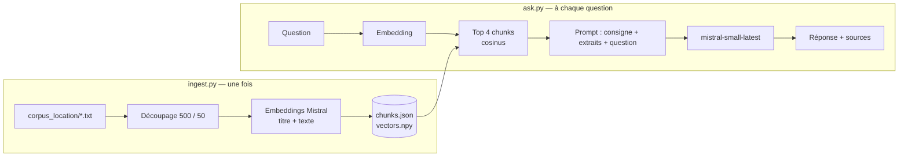

# Apprentissage RAG : du premier script Python à un RAG évalué et conteneurisé

Parcours de septembre-octobre 2026, commencé au niveau débutant en Python. L'objectif n'était pas de devenir développeur, mais de comprendre de l'intérieur ce qu'on déploie chez un client : comment un RAG trouve l'information, comment il se trompe, comment on le mesure et ce qu'il coûte.

Jusqu'au 15 octobre, j'ai écrit le code moi-même. Ensuite, j'ai défini l'architecture, les essais et les décisions, et le code a été rédigé avec un assistant IA, puis relu et lancé par moi.

## Ce que montre ce dépôt

| Partie | Question posée | Résultat principal |
|---|---|---|
| [1. RAG location](#ce-que-fait-le-projet) | Construire un RAG complet : découpage, embeddings, recherche, réponse sourcée, refus hors corpus | 30 fiches service-public.fr, stack 100 % Mistral |
| [2. Évaluation](#évaluation-et-essais-module-7) | Mesurer avant de régler : 15 questions figées, une variable changée à la fois | 12/15 → 13/15 réponses correctes ; LLM-juge d'accord avec la notation humaine sur 14/15 puis 15/15 |
| [3. Workflow ou agent ?](#workflow-reformulation-ou-agent--15-octobre) | Un agent qui choisit ses recherches fait-il mieux qu'un workflow fixe ? | Même qualité (15/15), mais 2,3 fois plus de tokens : workflow retenu |
| [4. Projet final : assurance](#projet-final--rag-sur-des-conditions-générales-dassurance-16-18-octobre) | CG habitation de 3 assureurs, pages scannées (OCR), document volontairement périmé | Recherche 15/18 ; réponses correctes 4/10 à la notation humaine ; goulot identifié : les questions comparatives entre assureurs |
| [5. Déploiement](#interface-et-déploiement) | Interface pour un utilisateur qui ne code pas, livrée en conteneur | App Streamlit sous Docker, avec la clé API et l'index hors de l'image |

Trois leçons qui reviennent dans tout le dépôt :
- **Une consigne oriente, la structure contraint.** Quand le modèle ignore une règle du prompt, la solution est dans le code (une recherche par assureur, une limite de tours), pas dans une consigne plus insistante.
- **Mesurer avant de complexifier.** L'agent et la reformulation semblaient des améliorations. Mesurés, ils n'apportaient rien ou dégradaient.
- **Les limites sont écrites à côté des chiffres :** une seule exécution, un jeu de développement, une vérité terrain non validée par un expert.

## Interface et déploiement

L'interface (`app.py`) interroge le RAG assurance. On coche les assureurs, on pose une question, et on obtient la réponse avec les extraits cités (assureur, page, natif ou scan).

```powershell
docker build -t rag-assurance .
docker run --rm -p 8501:8501 --env-file .env `
  -v "${PWD}/chunks_assurance.json:/app/chunks_assurance.json:ro" `
  -v "${PWD}/vectors_assurance.npy:/app/vectors_assurance.npy:ro" `
  rag-assurance
# puis http://localhost:8501
```

L'image ne contient que le code et les bibliothèques. La clé API est passée au lancement, et l'index (qui contient le texte des CG, non republiables) est monté depuis la machine, en lecture seule. Les CG, les scans et l'index ne sont pas dans ce dépôt : l'app ne se relance donc pas telle quelle depuis GitHub.

---

# Détail du parcours

## Parcours d'apprentissage

Ce RAG est l'aboutissement d'un parcours en modules. Etapes précédentes : appels d'API avec `requests` et gestion des erreurs, manipulation de JSON, lecture et découpage de fichiers, appels à un LLM (résumé de document en JSON, conversation multi-tours, calcul du coût en tokens), embeddings et recherche sémantique.

## Ce que fait le projet
Ce projet permet aux locataires et aux bailleurs d'obtenir rapidement des réponses à des questions précises sur la location immobilière (préavis, restitution du dépôt de garantie, obligations du propriétaire, etc.), sans avoir à parcourir manuellement de nombreux documents.

Le système repose sur une architecture RAG (Retrieval-Augmented Generation) qui s'appuie sur un corpus de 30 documents issus du site officiel Service-Public.fr. À partir d'une question en langage naturel, il recherche les informations pertinentes dans cette base documentaire, puis génère une réponse contextualisée à l'aide d'un modèle de langage. Les réponses sont accompagnées de sources citées, permettant à l'utilisateur de vérifier les informations fournies.

Le système est conçu pour limiter les réponses non fondées : lorsqu'aucune information pertinente n'est trouvée dans le corpus, il doit indiquer qu'il ne dispose pas des éléments nécessaires pour répondre.

Ce projet d'apprentissage vise à comprendre et à expérimenter les mécanismes fondamentaux d'un RAG, de la recherche documentaire à la génération de réponses sourcées.

## Architecture

Le système fonctionne en deux phases : l'**indexation**, lancée une fois (ou quand le corpus change), et la **requête**, à chaque question.





| Fichier | Rôle | Entrée | Sortie |
|---|---|---|---|
| `doc_utils.py` | Lire et découper les documents (module utilitaire) | Dossier de `.txt` / un texte | Liste de `{source, texte}` / liste de chunks |
| `embed_utils.py` | Vectoriser des textes, mesurer leur proximité (module utilitaire) | Liste de textes / deux vecteurs | Liste de vecteurs / score cosinus |
| `ingest.py` | Construire l'index | `corpus_location/` | `chunks.json` + `vectors.npy` |
| `retrieve.py` | Trouver les k chunks les plus proches d'une question | Question + index | k paires (score, chunk) |
| `ask.py` | Répondre à une question avec sources | Question | Réponse sourcée ou refus |

### Lancer le projet

```powershell
pip install -r requirements.txt
# fichier .env à la racine : MISTRAL_API_KEY=ta_clé
python ingest.py                      # construit chunks.json et vectors.npy (une fois)
python ask.py "Quel est le préavis pour un logement meublé ?"
```

### Détail par fichier

## Fichier doc_utils.py
Contient deux fonctions qui permettent de lire les fichiers, de les découper en chunks qui serviront ensuite à alimenter le RAG #module utilitaire, importé par les autres scripts

    ### charger_documents(dossier)
    - **Rôle** : lire les fichiers `.txt` d'un dossier et les mettre en mémoire, sous une forme que le découpage peut utiliser. Elle lit seulement, elle ne modifie rien sur le disque.
    - **Entrée** : un nom de dossier (texte, ex. `"docs"`). Elle cherche elle-même les fichiers avec `glob("*.txt")`, donc les autres formats (`.md`, `.pdf`) sont ignorés.
    - **Sortie** : une liste de dicts, un par fichier, avec les clés `"source"` (nom du fichier) et `"texte"` (son contenu).
    - **Ce qui peut casser sans bruit** : un dossier qui existe mais ne contient aucun `.txt` renvoie `[]` sans erreur. Protection : dans `main.py`, le garde « aucun chunk » arrête le programme avec un message clair. Un dossier inexistant, lui, lève une `FileNotFoundError`, donc ce n'est pas silencieux.

    ### chunk_text(text, size, overlap)
    - **Rôle** : découper un texte en morceaux plus petits, qui serviront ensuite dans le RAG.
    - **Entrée** : un seul texte à la fois (`str`), une taille de chunk (entier) et un chevauchement (entier).
    - **Sortie** : la liste des chunks de ce texte. Chaque chunk fait au plus `size` caractères, seul le dernier peut être plus court. La liste unique de tous les chunks est construite par `main.py`, avec `extend`.
    - **Ce qui peut casser sans bruit** : la fonction coupe aux positions, sans regarder les mots, donc un chunk peut commencer ou finir au milieu d'un mot (`'re le mont' suivi de 'ontant du '`), ce qui le rend peu exploitable. Ce cas n'est pas encore protégé. Les autres risques le sont : `overlap` invalide par une `ValueError`, chunk de fin redondant par la règle `i == 0 or i + overlap < len(text)`, texte vide par le `continue` de `main.py`.

    un RAG complet (ingestion, retrieval avec préfixe de titre, génération Mistral avec sources), deux diagnostics menés par tests (retrieval, puis génération), et une première évaluation sur 7 questions figées.

## Fichier embed_utils.py

Rôle : Génère des embeddings à partir de textes grâce à l’API Mistral, afin de les représenter sous forme de vecteurs numériques. Définit également une fonction de similarité cosinus permettant de mesurer la proximité entre deux vecteurs et donc d’évaluer la similarité sémantique entre des textes. #module utilitaire, importé par les autres scripts

Entrée :
textes : liste de textes à transformer en embeddings.
a, b : deux vecteurs numériques à comparer.

Sortie :
embed(textes) : liste de vecteurs numériques représentant les textes.
cosinus(a, b) : score de similarité compris entre -1 et 1, où une valeur proche de 1 indique une forte proximité entre les vecteurs.

## Fichier ingest.py
Rôle : Charge les documents du corpus, les découpe en segments (chunks) de 500 caractères avec un chevauchement de 50 caractères afin de conserver le contexte entre les segments. Associe à chaque chunk son titre et sa source, puis génère un embedding pour chaque segment à l’aide de l’API Mistral. Enfin, sauvegarde les chunks dans chunks.json et leurs vecteurs dans vectors.npy pour permettre leur utilisation lors de la recherche sémantique.

Entrée :
corpus_location : dossier contenant les documents à traiter.
size : taille maximale souhaitée des chunks (500 caractères).
overlap : nombre de caractères partagés entre deux chunks successifs (50 caractères).
L’API Mistral : utilisée pour générer les embeddings.

Sortie :
chunks.json : fichier contenant les chunks textuels, leur titre et leur document source.
vectors.npy : fichier contenant les embeddings associés aux chunks, utilisés pour calculer la similarité sémantique lors de la recherche.
Des informations affichées dans la console : nombre de documents chargés, nombre de vecteurs générés et dimension de chaque vecteur.

Gestion des erreurs : le programme s’arrête si le dossier est introuvable ou si aucun document n’a été chargé.


## Fichier retrieve.py

Rôle : Charge l’index documentaire constitué des chunks et de leurs embeddings, puis recherche les segments les plus pertinents par rapport à une question utilisateur. La question est transformée en embedding via l’API Mistral, puis comparée aux vecteurs des chunks à l’aide de la similarité cosinus. Les résultats sont ensuite triés par score décroissant afin de récupérer les k segments les plus proches sémantiquement.

Entrée :
chunks.json : fichier contenant les segments textuels, leurs titres et leurs sources.
vectors.npy : fichier contenant les embeddings associés aux chunks.
question : question posée par l’utilisateur, transmise en argument lors de l’exécution du script.
k : nombre de chunks les plus pertinents à récupérer (4 par défaut).

Sortie :
chunks, vectors : les segments documentaires et leurs vecteurs chargés en mémoire.
resultats : liste des k chunks les plus pertinents, chacun associé à son score de similarité cosinus, triée du score le plus élevé au plus faible.
Gestion des erreurs : le programme s’arrête si aucun argument n’est fourni ou si le nombre de chunks ne correspond pas au nombre de vecteurs de l’index.


## Fichier ask.py

Rôle : Permet à l’utilisateur de poser une question en langage naturel sur la location de logements et d’obtenir une réponse générée à partir du corpus documentaire. Le script récupère les chunks les plus pertinents grâce au module `retrieve`, assemble leurs contenus et leurs sources, puis transmet le contexte ainsi que la question à l’API Mistral, en utilisant le modèle `mistral-small-latest`. Un prompt système impose au modèle de s’appuyer uniquement sur les extraits fournis et de citer les sources entre crochets pour chaque affirmation. Si aucun extrait ne traite du sujet de la question, le modèle doit indiquer que l’information n’a pas été trouvée dans les documents.

Entrée :
 `question` : question de l’utilisateur, transmise en argument lors de l’exécution du script.
`chunks.json` et `vectors.npy` : fichiers contenant les segments documentaires et leurs embeddings, utilisés pour la recherche des extraits pertinents.
`MISTRAL_API_KEY` : clé d’accès à l’API Mistral, chargée depuis les variables d’environnement.
`mistral-small-latest` : modèle utilisé pour générer la réponse.

Sortie :
Les chunks récupérés, accompagnés de leur score de similarité cosinus et de leur source, affichés dans la console.
Une réponse en langage naturel générée par Mistral à partir des extraits sélectionnés, avec des références aux documents sources.
Un message de refus prédéfini si aucun extrait ne traite du sujet de la question.

Gestion des erreurs : le programme s’arrête si aucune question n’est fournie. Il dépend également de la disponibilité des fichiers d’index et de l’accès à l’API Mistral.

## Choix techniques

| Choix | Raison | Mesuré ? |
|---|---|---|
| Chunks de 500 caractères, overlap 50 | Valeur de départ du parcours, non comparée. Faiblesse connue : la coupe se fait au caractère, en plein mot ou en pleine liste (Q1 échoue pour cette raison). Piste : couper en fin de phrase ou par section. | Non — à mesurer au module 7 |
| k = 4 | Assez d'extraits pour répondre, sans ajouter de bruit ni de coût en tokens. | Non — à mesurer au module 7 |
| Préfixe du titre dans le texte vectorisé (`titre + ". " + texte`) | Le titre porte le sujet du document, absent des chunks du milieu. | Oui : chunk « Restitution » passé du rang 7 au rang 3 (0,841 → 0,855), sur une seule question — à confirmer au module 7 |
| `mistral-embed` | Cohérence de stack (un fournisseur, une clé), multilingue, aucun modèle à télécharger. | Non — choix par raisonnement |
| `mistral-small-latest` | Peu coûteux pour les premiers essais. | Non — essai avec un modèle plus gros prévu au module 7 |
| Consigne système stricte, puis assouplie | Avec la consigne stricte, le modèle refusait alors que les bons extraits étaient fournis. Assouplie : utiliser les extraits même formulés autrement, refuser seulement si aucun ne traite du sujet. | Oui : série 1 (stricte) 0/5 juste, 4 refus à tort ; série 2 (assouplie) 1 juste, 2 partielles, 2 fausses ; refus corrects maintenus (2/2) |
| Index en `json` + `npy`, cosinus avec `numpy` | 148 chunks : recherche exhaustive instantanée, aucune dépendance, calcul visible. | Non — migration vers Chroma au module 7 |

## Limites connues

- **Découpage au caractère** : les chunks coupent en plein mot ou en pleine liste, ce qui fait échouer des questions dont la réponse est pourtant dans le bon fichier (Q1, Q2).
- **Pas de seuil de pertinence** : le retrieval renvoie toujours k chunks, même quand la question est hors sujet (les scores restent élevés, autour de 0,8, avec des embeddings en français). Le refus repose entièrement sur la consigne du modèle.
- **Évaluation limitée** : 7 questions, notées à la main. Les résultats sont indicatifs, pas statistiques.
- **Erreurs non gérées** : index absent ou API Mistral indisponible font planter `ask.py` avec un traceback.
- **Pas de mémoire de conversation** : chaque question est traitée seule, sans tenir compte des précédentes.
- **Corpus** : 30 fiches rédigées à partir de Service-Public.fr à une date donnée ; une évolution de la loi n'est pas reflétée sans mise à jour et réindexation complète.

## Prochaines étapes

1. **Évaluation chiffrée** : 15 questions figées dans `eval.json` (dont 3 sans réponse), `evaluate.py` qui calcule le hit rate, réponses notées juste / partielle / fausse / refus correct.
2. **Essais une variable à la fois** : découpage par phrase ou par section, taille des chunks, k, préfixe du titre, modèle de génération — chaque essai consigné dans un tableau.
3. **Base vectorielle** : migration de l'index vers Chroma.
4. **Au-delà** : ingestion de PDF, interface minimale pour un utilisateur non technique.


## Évaluation et essais (module 7)

### Jeu de test

`eval.json` contient 15 questions figées (Q01 à Q15), écrites avant les essais :

- 12 questions dont la réponse est dans le corpus, dont une (Q14) qui demande deux fiches ;
- 3 questions hors corpus (Q06, Q07, Q15), pour vérifier que le système sait refuser.

Chaque question a une réponse attendue et la ou les fiches sources attendues.

### Métriques

| Métrique | Ce qu'elle mesure | Calcul |
|---|---|---|
| Hit rate (recall@k) | Le retrieval ramène-t-il le bon fichier ? | % des 12 questions dans le corpus dont une source attendue figure dans les k chunks récupérés |
| Rang moyen | À quelle position arrive le premier bon chunk ? | Moyenne du rang de la 1re bonne source ; une question non trouvée compte k + 1 (pénalité fixée avant les essais) |
| Réponses correctes | La réponse finale est-elle bonne ? | Notation des 15 réponses avec 5 étiquettes ; correctes = `juste` + `refus_correct` |

Étiquettes de notation :

| Étiquette | Règle |
|---|---|
| `juste` | Tous les éléments clés de la réponse attendue sont présents, explicitement |
| `partielle` | Au moins un élément clé manque ou n'est qu'implicite |
| `fausse` | Affirme le contraire de la réponse attendue, ou répond alors que l'information est absente du corpus |
| `refus_a_tort` | Dit ne pas trouver alors que la réponse attendue contient l'information |
| `refus_correct` | Dit ne pas trouver, et l'information n'est pas dans le corpus |

Les cas particuliers non demandés ne sont pas exigés. Les informations supplémentaires correctes ne font pas baisser la note.

Le hit rate est saturé (12/12 dès l'essai 1) et indulgent : il compte le bon fichier, pas le bon passage. Le rang moyen et les réponses notées sont donc les métriques qui départagent.

### Essais (une variable changée à la fois)

| Essai | Changement | Chunks | k | Hit rate | Rang moyen | Réponses correctes |
|---|---|---|---|---|---|---|
| 1a | Référence : chunks de 500 caractères, overlap 50, titre préfixé, prompt v1 | 148 | 4 | 12/12 | 1,58 | 12/15 |
| 1b | k = 8 | 148 | 8 | 12/12 | 1,58 | 11/15 |
| 2 | Ligne « Source » retirée du texte vectorisé | 129 | 4 | 11/12 | 1,50 | non mesuré |
| 3 | Découpage par paragraphe | 195 | 4 | 11/12 | 1,75 | non mesuré |
| 4 | Paragraphes + k = 8 | 195 | 8 | non mesuré | non mesuré | 11/15 (*) |
| 5 | Paragraphes + k = 8 + prompt v2 (assoupli) | 195 | 8 | non mesuré | non mesuré | 13/15 (*) |

(*) Notations des essais 4 et 5 non relues par un humain (voir Limites).

Ce que les essais montrent :

- **k = 8 n'améliore rien à lui seul** (1a → 1b) : le top 4 est inclus dans le top 8, donc le hit rate et le rang ne peuvent pas bouger, et la qualité des réponses ne s'améliore pas pour un coût en tokens doublé.
- **Le retrait de la ligne « Source » améliore le rang** (1,58 → 1,50) : cette ligne, commune aux 30 fiches, occupait une partie de chaque premier chunk et brouillait les embeddings. Le passage qui répond à Q02 passe du 40e au 16e rang.
- **Le découpage par paragraphe** remonte le passage de Q02 au 8e rang, mais fait perdre Q05 : la composition du hit rate change sans que le total bouge.
- **À l'essai 4, le goulot passe à la génération** : pour Q02 et Q05, le passage qui répond est dans le contexte envoyé au modèle (vérifié avec `debug.py`), et le modèle refuse quand même.
- **L'assouplissement du prompt** (essai 5) supprime les refus à tort sans faire perdre les refus corrects (3/3). Effet secondaire : le modèle ajoute une ligne « Interprétation retenue » à toutes ses réponses.

Configuration retenue : celle de l'essai 5, avec les réserves ci-dessous.

### LLM-juge

`juge.py` note automatiquement les réponses avec `mistral-small-latest` (température 0). Pour chaque question, le juge reçoit la question, la réponse attendue et la réponse générée, jamais le verdict humain. Il renvoie `{"verdict", "justification"}`. Le script contrôle que le verdict appartient aux 5 étiquettes et enregistre `invalide` sinon. `accord.py` compare ensuite les verdicts du juge à une référence humaine notée à l'aveugle.

| Test | Prompt du juge | Accord avec l'humain | Désaccords |
|---|---|---|---|
| Essai 1a (k = 4) | v1 | 14/15 (93 %) | Q04 : le juge affirme qu'un élément manque alors qu'il est présent, et pénalise des détails supplémentaires |
| Essai 1b (k = 8) | v2 (règle « informations supplémentaires ») | 15/15 (100 %) | aucun |

Le prompt v2 a été corrigé en regardant Q04. Il a donc été vérifié sur les réponses à k = 8, qui n'avaient pas servi à le corriger.

Lecture : le juge est fiable sur les cas faciles (refus, réponses courtes) et a échoué sur le seul cas difficile du premier test, avec une justification inventée. Le score d'accord ne suffit pas : il faut relire les désaccords et un échantillon de justifications.

### Limites

- **Peu de questions, une seule exécution** : 15 questions et une exécution par configuration. Un écart d'une question peut être du bruit.
- **Ajustement sur le jeu de test** : k et le prompt de l'essai 5 ont été choisis après avoir vu les échecs sur ces 15 questions. Le 13/15 surestime probablement la performance sur des questions nouvelles. Il faudrait un jeu de test mis de côté, jamais regardé pendant les réglages.
- **Essais 4 et 5 notés par Claude** : leurs notations n'ont pas été relues par un humain. À renoter avec le juge validé, puis à vérifier sur un échantillon.
- **Un seul annotateur, non juriste** : la référence humaine repose sur une personne. Le corpus (30 fiches reformulées à partir de service-public.fr, licence Etalab) n'a pas été relu par un juriste.
- **Juge et générateur de la même famille** : les deux sont des modèles Mistral. Un juge peut favoriser les réponses d'un modèle proche (risque connu, non mesuré ici).
- **Essais 2 et 3 mesurés sur le retrieval seulement** : aucune réponse générée n'a été notée pour ces configurations.
- **Nom de fichier trompeur** : `notation_essai4.csv` contient en réalité la notation de l'essai 1 à k = 4. À renommer en `notation_essai1_k4.csv`.

## Workflow, reformulation ou agent ? (15 octobre)

### Question posée
Un agent, qui décide lui-même quoi chercher et combien de fois, fait-il mieux qu'un workflow à chemin fixe ? Et à quel coût ?

### Configurations comparées
| Config | Chemin |
| --- | --- |
| A — workflow | Recherche avec la question brute, puis génération |
| B — workflow + reformulation | Le modèle reformule la question, recherche avec la requête obtenue, puis génération sur la question d'origine |
| C — agent | Le modèle appelle l'outil `retrieve` autant qu'il le juge utile, avec un maximum de 3 tours imposé par le code |

### Conditions communes
- **Index :** celui de l'essai 5 (découpage par paragraphe, sans ligne « Source », 195 chunks).
- **Réglages :** k = 8, température 0, `mistral-small-latest`.
- **Prompt :** règles de réponse communes aux trois configurations (`prompts.py`, prompt v3). L'agent ne reçoit en plus que ce qui lui est propre : utiliser l'outil, chercher une fois par sujet, relancer une recherche si besoin.
- **Notation :** le juge du 13 octobre, inchangé. Son code a été réorganisé, puis vérifié par un test de non-régression (15 verdicts identiques).
- **Règle fixée avant de voir les scores :** une sortie « limite atteinte » sur une question hors corpus compte comme un refus correct, et elle est signalée à part.

### Résultats (une exécution)
| Config | Correctes | Fausses | Refus à tort | Sorties par limite | Appels | Tokens entrée | Tokens sortie |
| --- | --- | --- | --- | --- | --- | --- | --- |
| A — workflow | 15/15 | 0 | 0 | 0 | 15 | 12 083 | 700 |
| B — reformulation | 13/15 | 1 (Q02) | 1 (Q04) | 0 | 30 | 15 207 | 1 072 |
| C — agent | 15/15 | 0 | 0 | 1 | 32 | 27 552 | 1 675 |

### Lecture
- **L'agent n'améliore pas la qualité sur ce jeu.** Il consomme pourtant 2,3 fois plus de tokens d'entrée, car il relit tout l'historique à chaque tour. Il n'a cherché plusieurs fois que sur des questions hors corpus, où ça ne sert à rien.
- **La reformulation dégrade le résultat.** Sur Q02, elle transforme « y retourner » en « résilier le bail ». La génération adapte ensuite son interprétation aux mauvais extraits, avec une source valide : l'erreur ne se voit pas. Une consigne interdisant de changer l'intention n'a pas corrigé la dérive.
- **La règle « une recherche par sujet » a été ignorée par l'agent sur Q14.** C'est la troisième fois : une consigne oriente, seule la structure contraint.
- **Décision :** garder le workflow A.

### Limites
- **Jeu de développement :** les règles du prompt v3 viennent d'échecs observés sur ces mêmes questions, donc ce score est probablement optimiste. Il faudrait le confirmer sur des questions neuves, jamais utilisées pour régler le système.
- **Plafond :** A et C sont tous les deux à 15/15, et le jeu ne contient aucune question qui exige plusieurs recherches enchaînées. Il ne mesure donc pas ce pour quoi un agent est fait. La conclusion vaut pour ce type de questions seulement.
- **Une seule exécution :** le nombre de sorties par limite est passé de 2 (essai à blanc) à 1 avec le même code. Un écart d'une question peut être du bruit.
- **Juge non vérifié sur ce style de réponse :** il a été étalonné sur les réponses de l'essai 1, plus courtes que celles de l'agent.
- **Tokens d'embedding non comptés :** cela sous-estime le coût de l'agent quand il cherche plusieurs fois.
- **Comparaison avec l'essai 5 :** le score de A n'est pas comparable au 13/15 de l'essai 5, car le prompt et la température ont changé.

### Fichiers
`prompts.py`, `reformulation.py`, `compare.py`, `juge.py` (rendu importable), `juge_compare.py`, `synthese.py`, `reponses_comparaison.json`, `verdicts_comparaison.json`

## Projet final : RAG sur des conditions générales d'assurance (16-18 octobre)

### Question posée

Un RAG peut-il répondre à des questions d'assurés sur la garantie vol, à partir des conditions générales (CG) d'assurance habitation de trois assureurs, dont des pages scannées au téléphone et un document volontairement périmé ?

### Corpus

| Document | Pages | Édition | Particularité |
|---|---|---|---|
| CG MAIF réf. M5202AHA | 114 | mai 2026 | 4 pages remplacées par leur scan (p. 21, 51-53) |
| CG MMA n° 410 S | 80 | juillet 2024 | 4 pages remplacées par leur scan (p. 16-19) |
| CG AXA | 70 | avril 2009 | Gardé volontairement : antérieur à la loi Hamon (2014), pour tester l'obsolescence ; 1 page scannée (p. 7 imprimée = p. 9 du PDF) |

Les CG ne sont pas republiables : les PDF, les scans, le cache OCR et `chunks_assurance.json` sont exclus du dépôt (`.gitignore`).

### Chaîne de traitement

| Étape | Fichier | Choix |
|---|---|---|
| Extraction | `ocr_corpus.py` | Mistral OCR sur les PDF natifs et les scans, avec cache et reprise après erreur 429 |
| Contrôle des pages | `verifier_pages.py` | Vérifie que chaque scan correspond à la bonne page ; registre `corpus_assurance/documents.json` (page imprimée et position dans le PDF) |
| Découpage | `ingest_assurance.py` | Par paragraphe, petits paragraphes regroupés jusqu'à ~500 caractères, gros tableaux découpés par groupes de lignes avec en-tête répété ; préfixe assureur dans le texte vectorisé ; métadonnées assureur / référence / édition / page / origine (natif ou scan) → 2 195 chunks |
| Embeddings | `embed_assurance.py` | `mistral-embed`, lots de 64 |
| Génération | `generate_assurance.py` | k = 8, `mistral-small-latest`, température 0, prompt v4 (`prompts.py`) |
| Évaluation | `evaluate_assurance.py`, `juge_assurance.py` | Recherche mesurée sans appel d'API ; réponses notées par le LLM-juge, étalonné sur un échantillon noté à la main |

**Prompt v4** (le v3 du projet location reste intact) : ne jamais transposer la règle d'un assureur à un autre ; répondre assureur par assureur et dire quand l'un d'eux est absent des extraits ; citer `[MAIF p.21]` ; signaler un document de plus de cinq ans ; renvoyer aux conditions particulières quand la réponse dépend du contrat souscrit.

### Jeu de questions

20 questions formulées comme un client (`eval_assurance.json`) : 6 simples, 4 comparatives entre assureurs, 3 sur des pages scannées, 2 sur un terme exact (référence de contrat), 3 sur le document AXA périmé, 2 hors corpus. Toutes portent sur la garantie vol.

### Résultats (une exécution, 18 octobre)

**Recherche** (18 questions, hors corpus exclues) :

| Indicateur | Résultat |
|---|---|
| Hit rate à k = 8 | 15/18 |
| Rang moyen (pénalité 9) | 3,17 |
| MRR | 0,61 |
| Recall@8 (part des pages attendues retrouvées) | 71 % — 18 % sur les 4 comparatives |
| Precision@8 (part des 8 extraits venant d'une page attendue) | 19 % |

Les trois échecs de recherche (P08, P09, P16) sont deux comparatives et une question sur le document périmé. La precision basse est attendue avec k = 8 et une seule page pertinente par question simple : elle mesure le bruit envoyé au modèle, pas un échec.

**Réponses**, deux mesures :

| Mesure | Correctes (juste + refus correct) | Détail |
|---|---|---|
| Notation humaine, 10 questions | 4/10 | 3 justes, 3 partielles, 3 fausses, 1 refus correct |
| LLM-juge, 20 questions | 8/20 | 6 justes, 4 partielles, 7 fausses, 1 refus à tort, 2 refus corrects |

**Accord du juge avec la notation humaine : 7/10** (15/15 sur le corpus location). Les trois désaccords n'ont pas la même cause :
- P01 : la notation humaine compte une omission grave (ne pas dire de porter plainte) comme fausse ; la grille du juge la classe partielle. Deux règles différentes, pas une erreur du juge.
- P02 : erreur du juge, qui n'a pas vu que la réponse contredisait l'attendu (« MMA ne remboursera pas » au lieu de « en principe oui »).
- P18 : réponse attendue mal construite (elle exigeait la loi Hamon, absente du corpus ; on ne pouvait exiger que le signalement d'un document périmé).

Sur ce domaine, 7/10 ne suffit pas pour remplacer la notation humaine. Choix retenu : ne pas modifier la grille du juge, pour ne pas la régler sur les 10 réponses qui servent à la tester (ce serait gonfler l'accord sans rendre le juge meilleur) ; le réétalonner demandera un nouvel échantillon noté à la main. Les deux chiffres sont publiés avec cette limite.

**Par type de question (verdicts du juge) :**

| Type | Correctes | Lecture |
|---|---|---|
| Pages scannées | 3/3 | L'OCR tient sur ces pages, réponses au rang 1 |
| Hors corpus | 2/2 | Refus corrects, avec renvoi aux conditions particulières |
| Simples | 3/6 (dont P02, compté juste à tort par le juge : 2/6 en réalité) | Erreurs de génération (P01 oublie la plainte) et de recherche (P02 : la page définissant l'escalade n'est pas récupérée) |
| Comparatives | 0/4 | Point faible principal : les 8 extraits viennent presque tous d'un seul assureur ; MMA absent des extraits pour P07 et P09 |
| Terme exact | 0/2 | Réponses incomplètes ou hors sujet malgré une page trouvée (rangs 4 et 1) — verdicts du juge non revus à la main |
| Document périmé | 0/3 | Le modèle signale bien l'édition 2009, mais répond ensuite comme si la règle était actuelle (P18) ; un montant faux (P16, dont la page attendue n'est pas récupérée) |

**Coût** : ~1 440 tokens d'entrée et ~280 de sortie par question (28 836 / 5 666 sur les 20).

### Lecture

1. **Le goulot principal est structurel, pas un réglage.** Une recherche unique sur une question comparative est dominée par un seul assureur. Remède à tester : une recherche par assureur cité, filtrée sur la métadonnée `assureur` (même leçon que Q14 du projet location : une consigne oriente, la structure contraint).
2. **Les erreurs de génération sont des erreurs de fidélité** : un délai de 20 jours recopié « 5 jours » (P17), une conclusion contraire aux extraits (P02). Afficher et relire les sources reste nécessaire.
3. **Signaler un document périmé ne suffit pas** : le modèle avertit puis affirme. Pour un usage réel, le remède est dans le corpus (retirer ou marquer les documents périmés), pas dans le prompt.

### Limites

- **Vérité terrain non validée par un expert** : les réponses attendues ont été rédigées à partir des PDF par un assistant IA ; 11 questions sur 20 portent un point marqué « à vérifier ». C'est la limite principale : un accord juge / humain mesure la cohérence, pas la justesse — sur P02, les deux s'étaient d'abord trompés de la même façon.
- **Pages AXA corrigées après coup** : les pages attendues de P16, P17 et P18 avaient été saisies en numéro imprimé au lieu de la position dans le PDF (décalage de 2). Corrigées le 18 octobre ; c'est une erreur de saisie de la référence, pas un ajustement des réponses attendues.
- **Une seule exécution**, 20 questions, un seul modèle : résultats indicatifs, pas statistiques.
- **Juge étalonné sur 10 réponses seulement** (7/10) ; les 10 autres verdicts ne sont pas revus à la main.
- **Alias `mistral-small-latest`** : la version du modèle peut changer entre deux lancements.
- **Pas de règle de gravité** dans la grille : une omission qui ferait mal agir un assuré compte comme une erreur mineure.

### Prochaines étapes

1. Recherche par assureur pour les questions comparatives, mesurée sur les 4 questions concernées puis sur un jeu de questions neuves.
2. Faire valider les réponses attendues par un professionnel de l'assurance.
3. Ajouter une règle de gravité à la grille du juge, puis l'étalonner sur un nouvel échantillon.

### Fichiers

`ocr_corpus.py`, `verifier_pages.py`, `ingest_assurance.py`, `embed_assurance.py`, `diag_chunk.py`, `test_retrieval_assurance.py`, `generate_assurance.py`, `evaluate_assurance.py`, `juge_assurance.py`, `corpus_assurance/documents.json`, `eval_assurance.json`, `reponses_assurance.json`, `notation_assurance.csv`, `verdicts_juge_assurance.json`.
